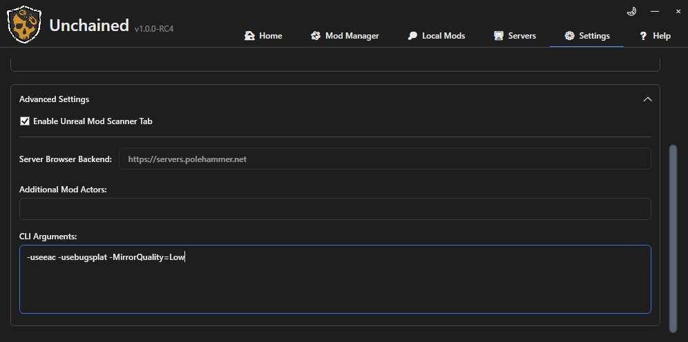
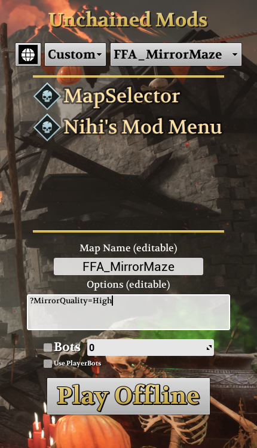

# MirrorKit


Live mirrors for Chivalry 2 Unchained maps: reflections that show you and other players, cheap shiny surfaces and breakable mirror tiles. MirrorKit is a **library**: it adds no map by itself, and maps that use it need it installed.

Version 0.9.0. Built with [ArgonSDK](https://github.com/Chiv2-Community/ArgonSDK) (Unreal Engine 4.25). The [MirrorLab](https://github.com/SageFlare/MirrorLab) map shows every mirror type; [MirrorMaze](https://github.com/SageFlare/MirrorMaze) is a full mirror maze built with it.

## Installation

Copy `MirrorKit.pak` **and** the map's own PAK into `Chivalry 2/TBL/Content/Paks/`, then launch through the [Unchained Launcher](https://github.com/Chiv2-Community/UnchainedLauncher). Server hosts need both files on the server too; the server itself does no mirror work.

Without `MirrorKit.pak` a map that uses it still loads, but its mirrors are missing.

## Mirror quality

Every map ships with mirror settings chosen by its maker. You can raise or lower them for your own game, and server hosts can set them for everyone.

**For your own game:** add a launch option under *Settings › Advanced Settings › CLI Arguments* in the Unchained Launcher, for example:

```
-MirrorQuality=Low
```



**For a server, or when playing offline:** put it in the map's **Options** box in the Unchained main menu, with a `?` instead of a `-`:

```
?MirrorQuality=High
```



Presets that come with MirrorKit:

| Preset | For |
| --- | --- |
| `Off` | No live reflections; mirrors show dark glass |
| `Low` | Weaker PCs: softer, slower reflections |
| `Medium` | A middle ground |
| `High` | The settings tuned for mirror-heavy maps |
| `Ultra` | Strong PCs: full resolution, the nearest mirrors update every frame |
| `Omega` | `Ultra` plus partnered mirror tunnels (a reflection inside a reflection), the most expensive |

**Jitter at high uncapped FPS:** if reflections look slightly jittery when you move sideways along a mirrored wall in first person (usually above about 200 FPS), add

```
-MirrorFocusRate=1000
```

The mirrors nearest you and in the middle of your view then update every frame, which removes the jitter. It costs some frame rate: on a mirror-heavy map, walking uncapped dropped from about 315 to 281 FPS (around 10 %) in my tests. With a frame cap of 144 FPS or lower, the nearest mirrors already update every frame, so you do not need it.

If you choose nothing, mirrors use the map's settings, or the server's if the host set any. You can also change single values instead of a whole preset, and hosts can set an optional cap. **[Every quality option](docs/QUALITY.md)**.

## Making a map with mirrors

Drag `BP_CaptureMirror` (or one of its variants) into your level, scale it, and it works with no other setup. **[The map-making guide](docs/MAP-MAKING.md)** covers installing the kit in ArgonSDK, placing mirrors, spacing rules, settings for many mirrors at once, the capture budget, breakable mirror tiles and every mirror setting. For mirror-heavy maps, read **[designing maps for mirror performance](docs/MAP-OPTIMIZATION.md)**.

| Mirror | What you see |
| --- | --- |
| `BP_CaptureMirror` | A true reflection: your full body, other players and the room. With a facing partner, an infinite-looking tunnel |
| `BP_Mirror_Funhouse` | Magnified, gappy carnival look |
| `BP_Mirror_Headless` | Your reflection has no head |
| `BP_Mirror_StretchHead` | Your head stretches as you look up and down |
| `BP_Mirror_Ghost` | Your body is invisible; your weapons float |
| `BP_MirrorTileLive` | Breakable tiles showing a live reflection on both sides |
| `BP_MirrorTile` / `BP_MirrorTile_NoSnow` | Breakable tiles with a still reflection (cheap) |

Every effect is per viewer: a ghost or headless mirror changes only *your own* reflection as *you* see it.

## Known limitations

- Reflections of mirrors inside other independent mirrors are plausible but not geometrically exact.
- Sheathed weapons in first-person reflections hang on the third-person body, so they can sit slightly off the reflected body (since 0.8.0; before, they did not appear).
- Live tiles show one reflection level; still tiles never show players.

[Version history](docs/CHANGELOG.md).

## License

Original MirrorKit work is licensed under the MIT License. See `LICENSE` and `THIRD_PARTY_NOTICES.md`.
