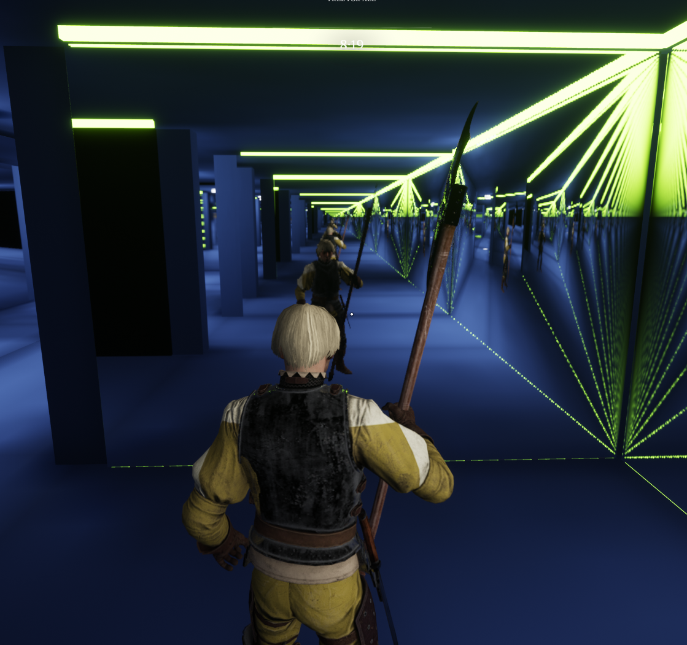
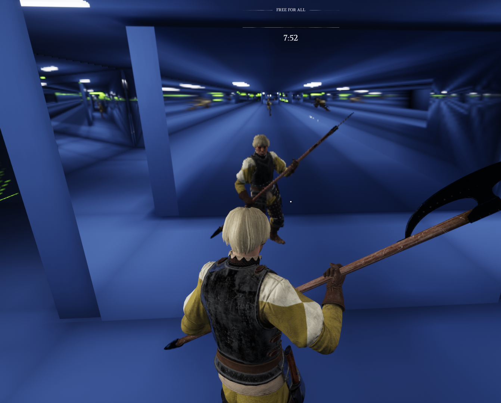

# Mirror quality options

Players and server hosts can change how MirrorKit mirrors look and how much they cost, without touching the map. This page lists every option. For a quick start, see [Mirror quality on the home page](index.md#mirror-quality).

## Where the options go

| Where | Who | Format |
| --- | --- | --- |
| Launch options in the Unchained Launcher (*Settings › Advanced Settings › CLI Arguments*) | a player, for their own game | `-Key=Value`, e.g. `-MirrorQuality=Low` |
| The map's **Options** box in the main menu, or the server's map options | a server host for everyone on the server; also you when playing offline (you are the server then) | `?Key=Value`, e.g. `?MirrorQuality=High` |

Several options go one after another: `-MirrorQuality=Low -MirrorFocusRate=1000` or `?MirrorQuality=High?MirrorMaxRate=90`. In the Options box, `-Key=Value` does nothing; use `?`.

## How the layers combine

From first to last; a later layer wins:

1. **Map:** the map maker's settings.
2. **Server values (optional):** `?MirrorQuality=` and single values in the map options. Everyone on the server starts from these instead of the map's.
3. **Your choice (optional):** `-MirrorQuality=` and single values in your launch options. Up or down, freely.
4. **Server cap (optional):** `?MirrorMaxQuality=` and limits in the map options. Only values above a limit are lowered, for everyone on the server, including players who chose nothing. Without a cap you can raise as you like.

If nobody chooses anything, mirrors run the map's settings.

Example: with `-MirrorQuality=Low` in your launch options and `?MirrorQuality=High` in the Options box when playing offline, you get **Low**: the Options box sets the server values, and your own launch choice comes after them. Only a cap (`?MirrorMaxQuality=`) can limit your choice, and a cap only lowers.

## Presets

| Preset | Resolution | Updates per second | Nearest mirrors | Distance | Captures per frame | Reflection AO | Smoothing | Anchor | Partners |
| --- | --- | --- | --- | --- | --- | --- | --- | --- | --- |
| `Omega` | 1.0 | 144 | every frame | 40 m | no budget | on | on | off | on |
| `Ultra` | 1.0 | 144 | every frame | 40 m | no budget | on | on | off | off |
| `High` | 0.5 | 90 | 144 | 25 m | 2 | off | on | off | off |
| `Medium` | 0.5 | 60 | 60 | 20 m | 3 | off | on | off | off |
| `Low` | 0.35 | 45 | 45 | 15 m | 2 | off | on | off | off |
| `Off` | no live reflections; mirrors show plain dark glass | | | | | | | | |

**Partners** are facing mirror pairs a map maker linked for a tunnel effect (a reflection inside a reflection). They cost extra (each mirror of a working pair renders one extra inner reflection, at half its update rate and sized to the screen), so only `Omega` turns them on. To keep a preset and add partners, follow it with the single value: `?MirrorQuality=High?MirrorPartners=1` (server) or `-MirrorQuality=High -MirrorPartners=1` (your own game). Maps without partnered mirrors look the same in `Omega` and `Ultra`. To switch on only partners and keep everything else as the map sets it, use `?MirrorPartners=1` (server) or `-MirrorPartners=1` (your own game).

| Partners on (Mirror Maze, `?MirrorPartners=1`) | Partners off (Mirror Maze default) |
| --- | --- |
|  |  |
| Facing mirrors show each other correctly: the reflection inside the reflection continues the corridor (the tunnel on the right). | Each mirror reflects on its own; reflections of other mirrors are approximate, so the geometry inside them looks wrong. |

Server map options `?MirrorQuality=` and `?MirrorMaxQuality=` accept built-in names or the path of a custom `BP_MirrorQuality` asset installed on the host. The host loads and checks the preset, applies inline settings, and sends only the resulting numeric values and flags to clients. Clients do not need the custom preset PAK. Missing or wrong-type presets contribute no values; inline settings still apply.

For example, install your preset PAK on the server and use `?MirrorQuality=/Game/Mods/MyPresets/MQ_Server`. Use `?MirrorMaxQuality=/Game/Mods/MyPresets/MQ_ServerCap` to apply a custom preset as limits. Use MirrorKit 0.7.0 or later on both host and clients; older clients do not understand every setting the host sends.

For your own game, use a preset name (`-MirrorQuality=Low`) or explicitly choose a `BP_MirrorQuality` asset from a PAK you installed (`-MirrorQuality=/Game/Mods/<Mod>/<Asset>`). This local launch option retains custom-asset loading; it is your choice and is not supplied by the server. The custom PAK is needed only on machines choosing that local preset. An unknown local preset changes nothing.

## Single values

The same keys work as launch options (`-Key=`) and as server values (`?Key=`). They apply after the preset in the same layer.

| Key | Value | Changes |
| --- | --- | --- |
| `MirrorResolution` | e.g. `0.5`, `1`; at most `2` | Largest reflection size (1 = 1280 × 720, 2 = 2560 × 1440). Each reflection is sized to the part of your screen it covers and never exceeds what the game renders (your screen x the in-game resolution scale), so a high value costs only where a mirror is large on screen. Values above 2 act as 2 |
| `MirrorRate` | updates per second, e.g. `90`; `0` = every N frames | How often mirrors update |
| `MirrorFocusRate` | updates per second; `1000` = every frame | How often the nearest and most central mirrors update |
| `MirrorDistance` | cm, e.g. `2500` | Mirrors farther than this stop updating |
| `MirrorCaptures` | captures per frame; `0` = budget off | The capture budget |
| `MirrorAO` | `0` off, `1` on | Ambient occlusion inside reflections |
| `MirrorSmooth` | `0` off, `1` on | Steady update interval when FPS fluctuates |
| `MirrorAnchor` | `0` off, `1` on | Count each interval from the last update |
| `MirrorPartners` | `0` off, `1` on | Partnered mirror tunnels (a reflection inside a reflection) |
| `MirrorFocusExempt` | `0` no, `1` yes | Whether nearby and central mirrors skip the capture budget (yes by default). `0` lets the budget slow them too: smoother worst frames, nearby reflections may update less often. Presets keep the map's choice |
| `MirrorsOff` | (no value; launch option only) | Turn live reflections off |

## Server cap

| Key | Limits |
| --- | --- |
| `?MirrorMaxQuality=<preset name or host asset path>` | Every value of that preset becomes a limit; only the host needs a custom preset PAK |
| `?MirrorMaxResolution=0.5` | Resolution |
| `?MirrorMaxRate=90` | Both update rates |
| `?MirrorMaxUpdateRate=90` | Normal update rate only |
| `?MirrorMaxFocusRate=144` | Focused update rate only |
| `?MirrorMaxDistance=2000` | Capture distance (cm) |
| `?MirrorMaxCaptures=3` | Captures per frame |
| `?MirrorNoAO` | Turns reflection AO off |
| `?MirrorNoPartners` | Turns partnered mirror tunnels off (any `?MirrorMaxQuality=` preset except `Omega` does too) |
| `?MirrorsOff` | Turns live reflections off |

When several limits apply, the strictest wins.

## Notes

- Mirrors render only on players' machines. A dedicated server does no mirror rendering, so hosting costs no GPU. The server shares only the recognized Mirror quality settings listed here with clients; unrelated map options are discarded before replication.
- Quality is applied when the match starts, and again on your machine if the server's options arrive later.
- A server's values are applied as the server sets them. A server can choose heavy settings, such as a long capture distance or a high update rate, so only join servers you trust. Your own `-MirrorQuality=` or single values replace the server's values; only a server cap can lower them.
- From 0.7.0, Off frees the video memory of the reflections. Mirrors that start Off never reserve it. When Off arrives after the mirrors started (a server's Off reaches you a moment after you join, even if you join mid-match), they switch to dark glass and release it. Mirror stand-ins (the small player copies used in reflections) are not created when mirrors start Off, and stay if Off arrives later; they are cheap. If mirrors are switched back on, the reflections are created again.
